# User Service

## C3 — Summary

This C3 Component Diagram details the internal logical architecture of the User Service (SVC-001), the core bounded context responsible for User Registration & Account Management. The diagram exposes 16 internal components organized across four layers: Presentation (REST Controllers), Application (Use Case Orchestrators), Domain (Credential and Token Domain Services), and Infrastructure (Repository, Cache Adapter, Outbox Publisher, Audit Logger, Error Handler). The service implements CQRS with a dedicated Query Service and read-replica path, the Transactional Outbox Pattern for reliable domain event publishing, and strict Auth Guard + Rate Limit Guard enforcement at the presentation boundary. External dependencies include a PostgreSQL User Database, Redis Cache Layer, Kafka/RabbitMQ Event Bus, Identity & Auth Service, and the Wishlist Service as a consumer of the User Identity Controller.

## C3 — Insights

- CQRS Separation: The Registration Application Service (write path) and CQRS Query Service (read path) are explicitly separated, enabling independent scaling of read-heavy profile lookups versus write-heavy registration flows. The read path leverages Redis cache before falling back to the PostgreSQL read replica.
- Transactional Outbox Pattern: The Outbox Publisher component ensures domain events (UserRegistered, AccountVerified, AccountUpdated) are published atomically with database writes, eliminating dual-write inconsistency and guaranteeing at-least-once delivery to the Event Bus without coupling the registration transaction to message broker availability.
- Auth Guard enforces user-scoped data isolation: All protected routes (Account Management Controller, User Identity Controller) pass through the Auth Guard, which validates JWT tokens and ensures mutations are scoped exclusively to the authenticated user — directly satisfying US-012 acceptance criteria for server-side data isolation.
- Rate Limit Guard at the presentation boundary: The Rate Limit Guard component is positioned as a pre-processing step on the Registration Controller, backed by Redis atomic counters, satisfying US-006 requirements for per-IP/per-user throttling on registration and OTP endpoints without impacting the business logic layer.
- Credential Domain Service encapsulates hashing: Password hashing logic (bcrypt/Argon2) is isolated in a dedicated Credential Domain Service, ensuring the algorithm can be swapped via configuration without touching the Registration Application Service — satisfying US-003 and US-007 security requirements and the DOR gate for algorithm approval.
- Token Domain Service coordinates OTP and email verification lifecycle: OTP token generation, email verification token issuance, and TTL-based expiry coordination are centralized in the Token Domain Service, with the Cache Adapter managing Redis-backed storage. This cleanly separates token lifecycle concerns from registration orchestration.
- Wishlist Service integration via User Identity Controller: The User Identity Controller exposes a dedicated read-only endpoint consumed by the Wishlist Service to resolve authenticated user identity references, satisfying F-03 technical considerations for server-side user association without coupling the Wishlist Service to internal User Service data models.
- Audit Logger as a cross-cutting infrastructure component: All three Application Services (Registration, Verification, Account Management) emit structured audit log entries through the Audit Logger, ensuring an immutable, tamper-evident trail for all account mutations — supporting GDPR compliance and the Audit & Logging Service downstream consumer.
- Error Handler centralizes API contract compliance: A dedicated Error Handler component maps domain exceptions to structured HTTP error responses, ensuring zero silent failures across all flows — directly satisfying acceptance criteria in US-002, US-004, US-009, US-010, and US-012 that mandate structured error payloads.
- Idempotency enforcement in Registration Application Service: The Registration Application Service caches idempotency keys via the Cache Adapter before processing, preventing duplicate account creation under retry scenarios — addressing the concurrent duplicate registration race condition described in F-01 technical considerations and US-002 AC.

## C3 — Interfaces

### Email Registration API (REST / HTTPS)
Accepts email-based user registration requests, triggers validation, credential hashing, account creation, and confirmation email dispatch via domain events.

- POST /api/v1/auth/register — accepts RegistrationRequestDTO (email, password)
- Returns 201 Created with user ID on success
- Returns 400 Bad Request with structured error payload on validation failure
- Returns 409 Conflict on duplicate email
- Returns 429 Too Many Requests on rate limit breach

### Mobile Registration API (REST / HTTPS)
Accepts mobile-number-based user registration requests, triggers OTP generation, caches OTP token in Redis with TTL, and initiates mobile verification flow.

- POST /api/v1/auth/register/mobile — accepts MobileRegistrationRequestDTO (mobile, password)
- Returns 201 Created with pending verification status on success
- Returns 400 Bad Request on invalid mobile format or password complexity failure
- Returns 409 Conflict on duplicate mobile number
- Returns 429 Too Many Requests on rate limit breach

### OTP Verification API (REST / HTTPS)
Accepts OTP codes submitted by users during mobile-based registration verification. Validates OTP against Redis-cached token, marks account as confirmed, and triggers session token issuance.

- POST /api/v1/auth/verify/otp — accepts OTPVerificationDTO (userId, otpCode)
- Returns 200 OK with session token on successful verification
- Returns 400 Bad Request on invalid or expired OTP
- Returns 404 Not Found if user or OTP record does not exist

### Email Verification API (REST / HTTPS)
Accepts email verification token clicks from users during email-based registration. Validates token TTL and authenticity, marks account as confirmed, and triggers session token issuance.

- POST /api/v1/auth/verify/email — accepts EmailVerificationDTO (token)
- Returns 200 OK with session token on successful verification
- Returns 400 Bad Request on invalid or expired token
- Returns 404 Not Found if token record does not exist

### User Profile Read API (REST / HTTPS)
Exposes the CQRS read-side endpoint for authenticated profile retrieval. Queries Redis cache first, falls back to PostgreSQL read replica. Enforces JWT authentication.

- GET /api/v1/users/{userId}/profile — returns UserProfileDTO
- Returns 200 OK with profile data
- Returns 401 Unauthorized if JWT is missing or invalid
- Returns 403 Forbidden if requesting user does not match userId
- Returns 404 Not Found if user does not exist

### Account Update API (REST / HTTPS)
Accepts authenticated account update requests. Validates JWT, enforces user-scoped mutation, persists changes, publishes AccountUpdated domain event, and logs audit entry.

- PUT /api/v1/users/{userId}/account — accepts AccountUpdateDTO
- Returns 200 OK with updated profile on success
- Returns 400 Bad Request on validation failure
- Returns 401 Unauthorized if JWT is missing or invalid
- Returns 403 Forbidden if requesting user does not match userId

### Account Deactivation API (REST / HTTPS)
Accepts authenticated soft-delete/deactivation requests. Sets deleted_at timestamp, publishes AccountUpdated domain event, and logs audit entry. Does not physically delete records.

- DELETE /api/v1/users/{userId}/account — soft-delete via deleted_at
- Returns 204 No Content on successful deactivation
- Returns 401 Unauthorized if JWT is missing or invalid
- Returns 403 Forbidden if requesting user does not match userId
- Returns 404 Not Found if user does not exist

### User Identity Lookup API (REST / HTTPS)
Exposes user identity resolution endpoints consumed by the Wishlist Service to associate wishlist entries with authenticated user accounts. Returns minimal identity projection.

- GET /api/v1/users/{userId}/identity — returns UserIdentityDTO (userId, status, accountActive)
- Returns 200 OK with identity projection
- Returns 401 Unauthorized if JWT is missing or invalid
- Returns 404 Not Found if user does not exist or is deactivated

### User Repository Interface (Repository Pattern / TypeORM / JPA)
Internal data access interface abstracting all PostgreSQL read and write operations for user account records. Supports transactional writes, soft-delete, and uniqueness constraint enforcement.

- save(userEntity) — persists new user account with hashed credentials
- findByEmail(email) — uniqueness check and profile lookup by email
- findByMobile(mobile) — uniqueness check and profile lookup by mobile
- findById(userId) — retrieves user account by primary key
- update(userEntity) — persists account mutations transactionally
- softDelete(userId) — sets deleted_at timestamp for deactivation
- findVerificationToken(token) — retrieves email verification token record

### Cache Adapter Interface (Redis Client / ioredis / Lettuce)
Internal interface abstracting all Redis interactions for OTP tokens, email verification tokens, idempotency keys, session data, and profile read-model cache entries.

- setOTP(userId, otpHash, ttlSeconds) — stores hashed OTP with TTL
- getOTP(userId) — retrieves hashed OTP for validation
- deleteOTP(userId) — invalidates OTP after successful verification
- setIdempotencyKey(key, ttlSeconds) — caches registration idempotency key
- getIdempotencyKey(key) — checks for existing idempotency key
- setProfileCache(userId, profileDTO, ttlSeconds) — caches profile read model
- getProfileCache(userId) — retrieves cached profile read model
- incrementRateLimitCounter(identifier, windowSeconds) — atomic rate limit counter

### Transactional Outbox Interface (Transactional Outbox Pattern / Kafka Producer)
Internal interface for publishing domain events via the Transactional Outbox Pattern. Writes event records to the outbox table within the same database transaction as the business operation, ensuring atomic event publishing.

- publishUserRegistered(userRegisteredEvent) — enqueues UserRegistered domain event
- publishAccountVerified(accountVerifiedEvent) — enqueues AccountVerified domain event
- publishAccountUpdated(accountUpdatedEvent) — enqueues AccountUpdated domain event

### Identity & Auth Service Interface (REST / HTTPS (Internal mTLS))
Internal interface for requesting JWT session token issuance from the Identity & Auth Service after successful account verification. Called by the Verification Application Service.

- POST /oauth/token — requests JWT access and refresh token issuance for confirmed user
- Returns access_token, refresh_token, and expiry metadata on success
- Returns 401 Unauthorized if account is not in confirmed state


## C3 — Relationships

- ? -> ?: Routes email and mobile registration, OTP, and email verification requests
- ? -> ?: Routes profile read, account update, and deactivation requests
- ? -> ?: Routes user identity lookup requests from Wishlist Service
- ? -> ?: Resolves authenticated user identity for wishlist ownership association
- ? -> ?: Enforces per-IP/per-user rate limiting before processing registration requests
- ? -> ?: Validates registration DTOs for format and complexity compliance
- ? -> ?: Delegates registration use case orchestration
- ? -> ?: Delegates OTP and email verification use case orchestration
- ? -> ?: Delegates unhandled domain exceptions for structured error response mapping
- ? -> ?: Validates JWT token and enforces user-scoped data isolation
- ? -> ?: Delegates account lifecycle use case orchestration
- ? -> ?: Delegates profile read queries to the read-side model
- ? -> ?: Delegates unhandled exceptions for structured error response mapping
- ? -> ?: Validates JWT token before identity lookup
- ? -> ?: Delegates identity lookup queries to the read-side model
- ? -> ?: Hashes user password using approved algorithm before persistence
- ? -> ?: Generates email verification tokens and OTP tokens
- ? -> ?: Persists new user account record transactionally
- ? -> ?: Stores idempotency keys and OTP tokens in Redis with TTL
- ? -> ?: Publishes UserRegistered domain event via Outbox Pattern
- ? -> ?: Emits structured audit log entry for account creation
- ? -> ?: Validates email verification token or OTP against TTL and authenticity rules
- ? -> ?: Retrieves and invalidates OTP tokens from Redis after successful verification
- ? -> ?: Marks user account as verified in the database
- ? -> ?: Publishes AccountVerified domain event via Outbox Pattern
- ? -> ?: Requests JWT session token issuance for confirmed user
- ? -> ?: Emits structured audit log entry for account verification
- ? -> ?: Reads and writes account records for update and soft-delete operations
- ? -> ?: Publishes AccountUpdated domain event via Outbox Pattern
- ? -> ?: Emits structured audit log entry for account mutations
- ? -> ?: Reads cached profile data from Redis before querying database
- ? -> ?: Queries PostgreSQL read replica for profile and identity data on cache miss
- ? -> ?: Reads and writes user account records via JDBC/SQL with transactional guarantees
- ? -> ?: Stores and retrieves OTP tokens, idempotency keys, session data, and profile cache entries
- ? -> ?: Publishes UserRegistered, AccountVerified, and AccountUpdated domain events

## C3 — External dependencies

- User Database: Service-owned relational datastore storing user accounts, hashed credentials, verification tokens, audit logs, and soft-delete records. Enforces uniqueness constraints on email and mobile fields. Provides primary write endpoint and read replica for CQRS query path.
- Cache Layer: In-memory cache storing OTP tokens, email verification tokens, idempotency keys, session data, and profile read-model cache entries. TTL-based expiry enforces security token lifecycle. Supports atomic operations for rate limiting counters.
- Event Bus / Message Broker: Asynchronous messaging backbone receiving domain events published by the User Service via the Transactional Outbox Pattern. Topics: user.registered, user.account.verified, user.account.updated. Consumed by Notification Service and Audit & Logging Service.
- Identity & Auth Service: External service responsible for JWT access and refresh token issuance, validation, and revocation. Called by the Verification Application Service after successful account confirmation to establish authenticated sessions.
- API Gateway: Centralized entry point routing all client requests to the User Service. Handles TLS termination, JWT pre-validation, rate limiting enforcement, and request tracing before forwarding to User Service controllers.
- Wishlist Service: External service consuming the User Identity Controller to resolve authenticated user references for wishlist ownership association. Requires valid JWT for all identity lookup requests.
- Email Provider: Third-party email delivery service used by the Notification Service (downstream consumer of Event Bus) to dispatch email verification links and welcome emails triggered by UserRegistered domain events.
- SMS / OTP Provider: Third-party SMS delivery service used by the Notification Service (downstream consumer of Event Bus) to dispatch OTP codes for mobile-based registration triggered by UserRegistered domain events.

## C3 — Diagram

```mermaid
flowchart TD
    client["👤 Client Application\n(Mobile / Web)"]
    apiGateway["API Gateway\n(Kong / AWS API Gateway)"]
    wishlistService["Wishlist Service\n(External Container)"]
    identityAuthService["Identity & Auth Service\n(OAuth 2.0 / JWT)"]
    userDb[("User Database\n(PostgreSQL)")]
    cacheLayer[("Cache Layer\n(Redis)")]
    eventBus[/"Event Bus\n(Kafka / RabbitMQ)"/]
    emailProvider["Email Provider\n(SendGrid / AWS SES)"]
    smsProvider["SMS / OTP Provider\n(Twilio / AWS SNS)"]

    subgraph svc001["User Service — SVC-001"]
        registrationController["Registration Controller\nREST Controller"]
        accountController["Account Management Controller\nREST Controller"]
        userIdentityController["User Identity Controller\nREST Controller"]
        requestValidator["Request Validator\nJoi / Zod / Bean Validation"]
        authGuard["Auth Guard\nJWT Middleware"]
        rateLimitGuard["Rate Limit Guard\nRedis-backed Middleware"]
        registrationAppService["Registration Application Service\nUse Case Orchestrator"]
        accountAppService["Account Management Application Service\nUse Case Orchestrator"]
        verificationAppService["Verification Application Service\nUse Case Orchestrator"]
        credentialDomainService["Credential Domain Service\nbcrypt / Argon2"]
        tokenDomainService["Token Domain Service\nJWT / UUID"]
        outboxPublisher["Transactional Outbox Publisher\nOutbox Pattern"]
        userRepository["User Repository\nRepository Pattern / ORM"]
        cqrsQueryService["CQRS Query Service\nRead Model"]
        cacheAdapter["Cache Adapter\nRedis Client"]
        auditLogger["Audit Logger\nStructured Logging / OpenTelemetry"]
        errorHandler["Error Handler\nCentralized Exception Mapper"]
    end

    client -->|"HTTPS"| apiGateway
    apiGateway -->|"Routes registration requests"| registrationController
    apiGateway -->|"Routes account management requests"| accountController
    apiGateway -->|"Routes identity lookup requests"| userIdentityController
    wishlistService -->|"Resolves user identity"| userIdentityController

    registrationController -->|"Rate limit check"| rateLimitGuard
    registrationController -->|"Validates DTOs"| requestValidator
    registrationController -->|"Delegates registration"| registrationAppService
    registrationController -->|"Delegates verification"| verificationAppService
    registrationController -->|"Exception handling"| errorHandler

    accountController -->|"JWT validation"| authGuard
    accountController -->|"Delegates account lifecycle"| accountAppService
    accountController -->|"Delegates profile read"| cqrsQueryService
    accountController -->|"Exception handling"| errorHandler

    userIdentityController -->|"JWT validation"| authGuard
    userIdentityController -->|"Delegates identity lookup"| cqrsQueryService

    registrationAppService -->|"Hash password"| credentialDomainService
    registrationAppService -->|"Generate tokens"| tokenDomainService
    registrationAppService -->|"Persist user account"| userRepository
    registrationAppService -->|"Cache idempotency / OTP"| cacheAdapter
    registrationAppService -->|"Publish UserRegistered"| outboxPublisher
    registrationAppService -->|"Audit log"| auditLogger

    verificationAppService -->|"Validate token / OTP"| tokenDomainService
    verificationAppService -->|"Retrieve / invalidate OTP"| cacheAdapter
    verificationAppService -->|"Mark account verified"| userRepository
    verificationAppService -->|"Publish AccountVerified"| outboxPublisher
    verificationAppService -->|"Request session token"| identityAuthService
    verificationAppService -->|"Audit log"| auditLogger

    accountAppService -->|"Read / write account"| userRepository
    accountAppService -->|"Publish AccountUpdated"| outboxPublisher
    accountAppService -->|"Audit log"| auditLogger

    cqrsQueryService -->|"Read cached profile"| cacheAdapter
    cqrsQueryService -->|"Query read replica"| userDb

    userRepository -->|"JDBC / SQL"| userDb
    cacheAdapter -->|"Redis Protocol"| cacheLayer
    outboxPublisher -->|"Kafka / AMQP"| eventBus

    eventBus -.->|"Consumed by Notification Service"| emailProvider
    eventBus -.->|"Consumed by Notification Service"| smsProvider
```



## C4 — Classes

- UserRegistrationController
- UserIdentityController
- AuthenticationFilter
- GlobalExceptionHandler
- RegistrationApplicationService
- UserCommandService
- UserQueryService
- RegistrationStrategy
- EmailRegistrationStrategy
- MobileRegistrationStrategy
- RegistrationStrategyFactory
- RegistrationRequestValidator
- DomainEventPublisher
- User
- UserId
- Email
- MobileNumber
- PasswordHash
- VerificationToken
- UserRegisteredEvent
- AccountVerifiedEvent
- AccountUpdatedEvent
- WriteUserRepository
- ReadUserRepository
- OutboxRepository
- UserRepositoryImpl
- OutboxRepositoryImpl
- OutboxEventPublisher
- OutboxPollerScheduler
- RedisCacheAdapter
- PasswordHasher
- JwtTokenValidator
- SessionTokenIssuer
- OtpGenerator
- VerificationTokenGenerator
- KafkaEventProducer

## C4 — Summary

This C4 Code diagram details the internal class-level architecture of the User Service (SVC-001), which owns the User Registration & Account Management bounded context. The diagram is organized into four canonical layers — Presentation, Application, Domain, and Infrastructure — plus a dedicated DTOs package. Key design decisions include: the Strategy Pattern for dual-channel registration (email vs. mobile), CQRS-separated read/write repository interfaces, the Transactional Outbox Pattern for reliable Kafka event publishing, Redis-backed OTP storage with TTL, bcrypt/Argon2 password hashing, JWT-based session issuance, and a UserIdentityController that exposes a lightweight identity API consumed by the Wishlist Service. Domain events (UserRegisteredEvent, AccountVerifiedEvent, AccountUpdatedEvent) are written atomically to an outbox table and relayed to Kafka by a scheduled OutboxPollerScheduler or CDC process, guaranteeing no lost events on crash. The diagram deliberately focuses on the classes and methods that carry real design decisions rather than exhaustively enumerating every utility class.

## C4 — Insights

- Strategy Pattern for dual-channel registration: RegistrationStrategyFactory selects EmailRegistrationStrategy or MobileRegistrationStrategy at runtime, eliminating if/else branching in RegistrationApplicationService and satisfying the Open/Closed Principle. New channels (e.g., social login) require only a new strategy implementation.
- CQRS separation is enforced at the repository interface level: WriteUserRepository and ReadUserRepository are distinct interfaces implemented by a single UserRepositoryImpl but injected independently into command-side (RegistrationApplicationService, UserCommandService) and query-side (UserQueryService) consumers. This enables independent read-replica routing and Redis cache-aside on the query path.
- Transactional Outbox Pattern guarantees reliable domain event delivery: DomainEventPublisher writes events to OutboxRepository within the same DB transaction as the User aggregate mutation. OutboxPollerScheduler (or Debezium CDC) reads unpublished events and forwards them to KafkaEventProducer, preventing dual-write inconsistency between PostgreSQL and Kafka.
- UserIdentityController exposes a dedicated /api/v1/users/{userId}/identity endpoint returning UserIdentityDTO (userId, email, accountStatus). This is the sole integration surface for the Wishlist Service (F-03), enforcing the Database-per-Service pattern — the Wishlist Service never accesses the User DB directly.
- Value Objects (UserId, Email, MobileNumber, PasswordHash) encapsulate validation and immutability within the domain layer. Email.of() and MobileNumber.of() throw domain exceptions on invalid input, ensuring invariants are enforced at construction time rather than scattered across service methods.
- VerificationToken is a first-class domain object with isExpired() and isValid() methods, supporting both email token (VerificationTokenGenerator) and OTP (OtpGenerator + RedisCacheAdapter with TTL) verification paths. This cleanly separates the two verification channels while sharing the same token validation contract.
- AuthenticationFilter + JwtTokenValidator implement the authentication gate required by US-012 (server-side wishlist data isolation): every inbound request to protected endpoints is validated before reaching controllers, and unauthenticated requests are rejected with a structured 401 response via GlobalExceptionHandler.
- PasswordHasher is an infrastructure-layer component injected into RegistrationApplicationService and used by PasswordHash.of() to produce the hash value object. The algorithm (bcrypt/Argon2) is configurable and gated by security team sign-off (US-003/US-007 DOR blocker), keeping the domain model algorithm-agnostic.
- OutboxEvent carries eventType, payload (JSON-serialized domain event), and status fields, enabling the OutboxPollerScheduler to implement idempotent at-least-once delivery to Kafka. KafkaEventProducer integrates with a SchemaRegistryClient for Avro/JSON Schema versioning, satisfying the event schema evolution requirement from PAT-003.
- SessionTokenIssuer is isolated in the infrastructure layer with configurable jwtSecret and tokenTtl, satisfying the token standard/expiry policy stakeholder dependency (US-008 DOR blocker). No session token is issued until AccountVerifiedEvent is confirmed, enforcing the 'no session before confirmation' invariant across both registration channels.

## C4 — Methods

- **RegistrationApplicationService.?** — Orchestrates full registration: validates request, selects strategy, hashes password, persists User, writes UserRegisteredEvent to outbox, returns UserProfileDTO. Transactional.
- **RegistrationApplicationService.?** — Validates VerificationToken, marks User as ACTIVE, writes AccountVerifiedEvent to outbox, issues JWT session token. Rejects expired/invalid tokens with structured error.
- **RegistrationApplicationService.?** — Validates OTP from Redis, marks User as ACTIVE, writes AccountVerifiedEvent to outbox, issues JWT session token. Enforces TTL expiry.
- **UserCommandService.?** — Loads User aggregate, applies profile update, persists via WriteUserRepository, publishes AccountUpdatedEvent to outbox.
- **UserCommandService.?** — Performs soft-delete by setting AccountStatus to DEACTIVATED. Does not physically delete the record. Publishes AccountUpdatedEvent.
- **UserQueryService.?** — Cache-aside read: checks Redis first, falls back to ReadUserRepository (read replica), populates cache on miss. Returns UserProfileDTO.
- **UserQueryService.?** — Returns lightweight UserIdentityDTO (userId, email, accountStatus) for Wishlist Service consumption. No sensitive fields exposed.
- **RegistrationRequestValidator.?** — Authoritative server-side validation: email/phone format, password complexity, and DB uniqueness check. Returns ValidationResult with field-level error details.
- **EmailRegistrationStrategy.?** — Generates VerificationToken, persists it, and publishes a domain event that triggers the Notification Service to dispatch the confirmation email.
- **MobileRegistrationStrategy.?** — Generates OTP, stores it in Redis with TTL, and publishes a domain event that triggers the Notification Service to dispatch the SMS OTP.
- **DomainEventPublisher.?** — Serializes the domain event and writes it to the OutboxRepository within the current DB transaction, guaranteeing atomic event registration.
- **OutboxEventPublisher.?** — Reads all UNPUBLISHED OutboxEvents, sends each to KafkaEventProducer, and marks them as PUBLISHED. Idempotent — safe to retry on failure.
- **User.?** — Transitions AccountStatus from PENDING_VERIFICATION to ACTIVE. Throws InvalidStateException if already ACTIVE or DEACTIVATED.
- **User.?** — Transitions AccountStatus to DEACTIVATED (soft-delete). Preserves record for audit and event replay purposes.
- **VerificationToken.?** — Returns true if current time exceeds expiresAt. Used by RegistrationApplicationService to reject stale tokens with a structured error response.
- **PasswordHasher.?** — Hashes plaintext password using the security-team-approved algorithm (bcrypt/Argon2). Never stores or logs the plaintext input.
- **SessionTokenIssuer.?** — Signs and returns a JWT with userId claim, roles, and configured TTL. Only called after account verification is confirmed.
- **AuthenticationFilter.?** — Extracts Bearer token, delegates to JwtTokenValidator, injects UserId into request context, or rejects with 401 ErrorResponseDTO for missing/invalid tokens.
- **RedisCacheAdapter.?** — Retrieves stored OTP for userId from Redis, compares with input, and deletes the key on successful match to enforce single-use semantics.

## C4 — Data structures

- User
- UserId
- Email
- MobileNumber
- PasswordHash
- VerificationToken
- OutboxEvent
- RegistrationRequestDTO
- UserProfileDTO
- UserIdentityDTO
- SessionTokenDTO
- ErrorResponseDTO
- UserRegisteredEvent
- AccountVerifiedEvent
- AccountUpdatedEvent

## C4 — Code relationships

- RegistrationApplicationService delegates channel-specific validation, user creation, and verification triggering to the strategy selected by RegistrationStrategyFactory. Eliminates if/else branching and satisfies OCP.
- All write operations (save, update, softDelete, saveVerificationToken) flow exclusively through WriteUserRepository, keeping the command path isolated from read concerns.
- All read operations flow through ReadUserRepository (targeting a read replica) with Redis cache-aside, keeping the query path isolated from write concerns.
- Domain events are written to the outbox table in the same DB transaction as the User aggregate mutation, guaranteeing atomic event registration and preventing lost events on crash.
- A scheduled poller (or Debezium CDC) reads PENDING outbox events and relays them to Kafka idempotently, then marks them PUBLISHED. Decouples DB commit from broker availability.
- Single concrete class implements both repository interfaces, with routing to primary DB for writes and read replica for reads, enforcing CQRS at the infrastructure level.
- The Wishlist Service calls GET /api/v1/users/{userId}/identity to verify user identity. This is the sole cross-service data access point, enforcing the Database-per-Service pattern.
- User aggregate is composed of immutable value objects that enforce their own invariants at construction time, keeping the aggregate root free of low-level validation logic.
- Every protected endpoint is guarded by AuthenticationFilter, which validates the JWT and injects the authenticated UserId into the request context, satisfying US-012 server-side data isolation requirements.
- DTOs decouple the API contract from internal domain models. Domain entities are never exposed directly in responses, preventing accidental leakage of sensitive fields (e.g., passwordHash).
- All dependencies are injected via constructor injection (TypeScript/Spring DI container), enabling mock-based unit testing of business logic without infrastructure dependencies.
- Domain events are created as immutable value objects and passed to DomainEventPublisher, which serializes them into OutboxEvent records for reliable Kafka delivery.

## C4 — Diagram

_(diagram omitted -- exceeds the reference file size budget)_

## API specification — Endpoints

### POST /api/v1/auth/register
Creates a new user account using email address as the primary identifier. Validates email format, password complexity, and email uniqueness before persisting. Dispatches a verification email upon success. Enforces idempotency via Idempotency-Key header.

### POST /api/v1/auth/register/mobile
Creates a new user account using a mobile number as the primary identifier. Validates mobile number format (E.164), enforces uniqueness, hashes password, and triggers OTP dispatch via SMS. Enforces idempotency via Idempotency-Key header.

### POST /api/v1/auth/verify/email
Validates the email verification token sent to the user's email address. On success, marks the account as confirmed and issues a JWT session token. Token is single-use and TTL-bound.

### POST /api/v1/auth/verify/otp
Validates the OTP code sent to the user's mobile number. On success, marks the account as confirmed and issues a JWT session token. OTP is single-use with a 5-minute TTL stored in Redis.

### GET /api/v1/users/{userId}/profile
Returns the profile data for the specified user. Implements CQRS read model — served from read replica or Redis cache. Only the authenticated user may retrieve their own profile (resource-level authorization).

### PUT /api/v1/users/{userId}/account
Updates mutable account fields (e.g., display name, mobile number, email) for the specified user. Publishes AccountUpdated domain event via Transactional Outbox Pattern. Only the authenticated user may update their own account.

### DELETE /api/v1/users/{userId}/account
Performs a soft-delete of the user account by setting the deleted_at timestamp. Account data is retained for compliance/audit purposes. Publishes AccountDeactivated domain event. Only the authenticated user may deactivate their own account.

### GET /api/v1/users/{userId}/identity
Returns minimal user identity data (userId, accountStatus) for internal service-to-service consumption. Used by the Wishlist Service to validate user ownership and account status before wishlist mutations. Secured via mTLS / internal service token.

### POST /api/v1/auth/token/refresh
Issues a new JWT access token using a valid refresh token. Enforces token expiry and rotation policies as defined by the Identity & Auth Service.

### POST /api/v1/auth/logout
Revokes the current JWT session token and refresh token. Adds tokens to the Redis revocation list for immediate invalidation.

### GET /health
Returns the health status of the User Service and its critical dependencies (database, Redis, Event Bus).

### GET /metrics
Exposes Prometheus-compatible metrics for the User Service (request counts, latencies, error rates). Consumed by Prometheus scraper.


## API specification — Summary

The User Service API (v1.0.0) provides a comprehensive set of RESTful endpoints covering the complete User Registration & Account Management bounded context for the Shopping App. The API is scoped to two related features: F-01 (User Registration & Account Management) and F-03 (Wishlist Management — user identity exposure).

**Core Capabilities:**
- **Dual Registration Paths:** Email-based (POST /auth/register) and mobile-based (POST /auth/register/mobile) registration flows, each with server-side validation, bcrypt/Argon2 password hashing, and asynchronous verification dispatch (email token or SMS OTP).
- **Account Verification:** Email token verification (POST /auth/verify/email) and OTP verification (POST /auth/verify/otp), both issuing JWT session tokens upon success. Tokens are single-use, TTL-bound, and stored as hashed values in Redis.
- **Session Management:** JWT token refresh (POST /auth/token/refresh) and session revocation/logout (POST /auth/logout) with Redis-backed token revocation list.
- **Account Lifecycle (CQRS):** Profile retrieval via CQRS read model with Redis caching and ETag support (GET /users/{userId}/profile), mutable account updates with domain event publication (PUT /users/{userId}/account), and soft-delete deactivation (DELETE /users/{userId}/account).
- **Internal Identity API:** A non-public endpoint (GET /users/{userId}/identity) secured via Istio mTLS, consumed exclusively by the Wishlist Service to validate user ownership and account status before wishlist mutations — directly supporting F-03 data isolation requirements (US-012).
- **System Endpoints:** Health check (/health) and Prometheus metrics (/metrics).

**Security Model:** RS256-signed JWTs, resource-level ownership enforcement (userId claim vs. path parameter), rate limiting on registration/OTP endpoints via Redis-backed counters, idempotency key enforcement on registration endpoints, and TLS 1.3 transport security.

**Error Contract:** All 4xx/5xx responses conform to a standard ErrorResponse envelope with machine-readable errorCode, human-readable message, field-level details array, traceId, and timestamp — enabling zero silent failures across all flows.

## API specification — Insights

- DUAL REGISTRATION PATHS: The API exposes two distinct registration endpoints (/auth/register for email, /auth/register/mobile for mobile) rather than a single polymorphic endpoint. This design decision aligns with the CQRS write-path separation and makes the validation logic, error codes, and verification channels explicit and independently evolvable without risk of breaking the other path.
- IDEMPOTENCY KEY ENFORCEMENT: Both registration endpoints require an Idempotency-Key header (UUID). This is critical for preventing duplicate account creation under network retry scenarios — a known race condition risk identified in F-01 technical considerations. The key is stored in Redis with a TTL window; duplicate requests return the original response without re-processing.
- 202 ACCEPTED vs 201 CREATED for Registration: Registration endpoints return 202 Accepted (not 201 Created) because account creation is a two-phase process — the account record is created but the account is not yet active until email/OTP verification completes. This accurately reflects the PENDING_VERIFICATION state and prevents clients from assuming immediate usability.
- 410 GONE for Expired Tokens: Expired or already-consumed verification tokens return 410 Gone rather than 400 Bad Request or 404 Not Found. This distinction is semantically important — 410 communicates that the resource existed but is permanently gone (consumed/expired), enabling clients to surface actionable messages ('request a new verification email') rather than generic error handling.
- CQRS READ MODEL with ETag Caching: GET /users/{userId}/profile is served from the CQRS read side (Redis cache + read replica). The endpoint supports ETag and If-None-Match headers for conditional GET requests, enabling 304 Not Modified responses and reducing unnecessary data transfer for profile polling scenarios (e.g., Wishlist Service checking account status).
- INTERNAL IDENTITY ENDPOINT ISOLATION: GET /users/{userId}/identity is intentionally scoped as an internal-only endpoint secured via Istio mTLS, not exposed through the public API Gateway. This enforces the principle of least privilege — the Wishlist Service receives only the minimal identity data it needs (userId, accountStatus) without access to PII fields (email, mobileNumber, passwordHash). This directly addresses US-012 data isolation requirements.
- SOFT-DELETE PATTERN: Account deactivation uses DELETE /users/{userId}/account returning 204 No Content, but the underlying implementation is a soft-delete (setting deleted_at timestamp). This preserves audit trail and compliance data while making the account inaccessible. The AccountDeactivated domain event is published via the Transactional Outbox Pattern to notify downstream consumers (e.g., Wishlist Service should handle deactivated user wishlist data per its product-lifecycle policy).
- STRUCTURED ERROR CONTRACT: All error responses use a consistent ErrorResponse envelope with machine-readable errorCodes. This is a hard contract requirement (US-002 AC: 'structured error payload per the API contract'). The errorCode taxonomy distinguishes between DUPLICATE_EMAIL, INVALID_EMAIL_FORMAT, PASSWORD_COMPLEXITY_VIOLATION, TOKEN_EXPIRED, RATE_LIMIT_EXCEEDED, and RESOURCE_OWNERSHIP_VIOLATION — enabling clients to implement precise, actionable UI feedback without string-parsing error messages.
- RATE LIMITING DESIGN GAP: Rate limiting thresholds (max attempts per IP/device per time window) are flagged as stakeholder-defined DOR blockers (US-006 AC). The API specification includes the rate limiting headers (X-RateLimit-Limit, X-RateLimit-Remaining, X-RateLimit-Reset, Retry-After) and the 429 error response structure, but the actual threshold values must be confirmed before the registration and OTP endpoints can be marked Ready for development.
- PASSWORD COMPLEXITY DOR BLOCKER: Password complexity rules (minimum length, required character classes) are referenced in validation_rules but marked as stakeholder-defined. The OpenAPI spec uses minLength: 8 as a placeholder. The actual rules must be confirmed by the security team before US-001, US-002, US-003, and US-007 can be marked Ready. The API contract will need to be updated to reflect the confirmed rules in the 400 error detail messages.
- TOKEN POLICY DOR BLOCKER: JWT token standard, signing approach, and expiry policy are referenced throughout the spec but flagged as requiring stakeholder/security team confirmation (US-008 DOR blocker). The spec uses RS256 as the recommended algorithm based on the technology stack, but expiresIn values are illustrative. The SessionTokenResponse schema includes expiresIn to communicate the actual policy to clients once confirmed.
- TRANSACTIONAL OUTBOX PATTERN: PUT /users/{userId}/account and DELETE /users/{userId}/account both publish domain events (AccountUpdated, AccountDeactivated) via the Transactional Outbox Pattern. This is not reflected in the HTTP response but is a critical architectural constraint — the event publication is atomic with the DB write, ensuring downstream consumers (Notification Service, Audit Service, Wishlist Service) receive reliable event notifications even under failure scenarios.
- WISHLIST SERVICE INTEGRATION CONTRACT: The GET /users/{userId}/identity endpoint is the explicit integration contract between the User Service and the Wishlist Service (F-03). The Wishlist Service must check accountStatus === 'ACTIVE' before permitting any wishlist mutation. This enforces the authentication gate requirement from F-03 technical considerations at the service boundary level, not just at the API Gateway JWT validation level.
- OTP BRUTE-FORCE PROTECTION: The OTP verification endpoint (POST /auth/verify/otp) uses atomic Redis operations for attempt counting. Exceeding the maximum attempt threshold returns 429 with a Retry-After header and invalidates the OTP. This prevents brute-force attacks on the 6-digit OTP space (1,000,000 combinations) within the 5-minute TTL window.
- CONCURRENCY SAFETY for DUPLICATE REGISTRATION: The 409 Conflict response for duplicate email/mobile is backed by a DB unique constraint (not just application-level checks). This handles the concurrent duplicate registration race condition identified in F-01 technical considerations — even if two requests pass application-level uniqueness checks simultaneously, the DB constraint ensures only one account is created and the second receives a structured 409 response.

API version: 1.0.0

## API specification — Data models

### Unnamed model

### Unnamed model

### Unnamed model

### Unnamed model

### Unnamed model

### Unnamed model

### Unnamed model

### Unnamed model

### Unnamed model

### Unnamed model

### Unnamed model

### Unnamed model

### Unnamed model

### Unnamed model

### Unnamed model

### Unnamed model

### Unnamed model

### Unnamed model

### Unnamed model

### Unnamed model

### Unnamed model

### Unnamed model


## API specification — Authentication

- Authorization: {'model': 'Resource-level ownership enforcement', 'description': 'Authenticated users may only read and mutate their own resources. The userId in the JWT claims is compared against the {userId} path parameter. Mismatches result in 403 Forbidden.', 'internal_service_isolation': "The Wishlist Service may only read user identity data via the internal /identity endpoint. All wishlist mutations are scoped to the authenticated user's userId extracted from the validated JWT — enforcing data isolation per US-012."}
- Rate limiting: {'headers': ['X-RateLimit-Limit: maximum requests allowed in window', 'X-RateLimit-Remaining: requests remaining in current window', 'X-RateLimit-Reset: Unix timestamp when window resets', 'Retry-After: seconds to wait (on 429 response)'], 'otp_verification': 'Atomic attempt counting in Redis. Maximum attempts per OTP token before invalidation — stakeholder-defined.', 'registration_endpoints': 'Configurable per IP/device per time window. Threshold and window duration are stakeholder-defined (DOR blocker). Enforced at API Gateway (COMP-001) using Redis-backed counters.'}

## API specification — Error handling

- All error responses conform to the standard ErrorResponse envelope: {errorCode, message, details[], traceId, timestamp}. This contract is mandatory — zero unstructured error responses.
- HTTP 400 Bad Request: Used for client-side validation failures (invalid email format, invalid mobile format, password complexity violation, missing required fields). The 'details' array contains field-level errors with {field, message, rejectedValue} for each violation.
- HTTP 401 Unauthorized: Returned when the Authorization header is missing, the JWT is malformed, or the JWT signature is invalid. Error codes: MISSING_TOKEN, INVALID_TOKEN.
- HTTP 403 Forbidden: Returned when the authenticated user attempts to access or mutate a resource they do not own (userId mismatch). Error code: RESOURCE_OWNERSHIP_VIOLATION.
- HTTP 404 Not Found: Returned when the requested user or token does not exist. Error codes: USER_NOT_FOUND, TOKEN_NOT_FOUND.
- HTTP 409 Conflict: Returned when a registration or update request uses an email or mobile number already associated with an existing account. Concurrent duplicate registrations are handled via DB unique constraint — the second request receives 409. Error codes: DUPLICATE_EMAIL, DUPLICATE_MOBILE_NUMBER.
- HTTP 410 Gone: Returned when an email verification token or OTP has expired or has already been consumed. Error codes: TOKEN_EXPIRED, TOKEN_ALREADY_USED. Partial accounts subject to TTL purge are never silently confirmed.
- HTTP 429 Too Many Requests: Returned when the rate limit threshold is exceeded on registration or OTP endpoints. Response includes Retry-After header. Error code: RATE_LIMIT_EXCEEDED. Zero over-threshold requests are silently passed through.
- HTTP 503 Service Unavailable: Returned when a critical dependency (database, Redis, notification service) is unavailable at the time of request. Error code: DEPENDENCY_UNAVAILABLE. Account is NOT silently created or confirmed during dependency outages.
- Idempotency: POST /register and POST /register/mobile require an Idempotency-Key header. Duplicate requests with the same key within the idempotency window return the original response without re-processing. Missing Idempotency-Key returns 400 with error code MISSING_IDEMPOTENCY_KEY.
- Notification delivery failure: If the email or SMS dispatch fails after account record creation, the account is NOT marked as confirmed and a 503 or appropriate error is surfaced. Zero accounts are silently confirmed due to notification delivery failure.
- Validation error structure example: {"errorCode": "VALIDATION_ERROR", "message": "Request validation failed", "details": [{"field": "email", "message": "Invalid email format", "rejectedValue": "not-an-email"}], "traceId": "abc-123", "timestamp": "[REDACTED-PHONE]T10:30:00Z"}
- Conflict error structure example: {"errorCode": "DUPLICATE_EMAIL", "message": "An account with this email address already exists. Please log in or use a different email.", "details": [], "traceId": "abc-124", "timestamp": "[REDACTED-PHONE]T10:30:01Z"}
- Token expired error structure example: {"errorCode": "TOKEN_EXPIRED", "message": "The verification token has expired. Please request a new verification email.", "details": [], "traceId": "abc-125", "timestamp": "[REDACTED-PHONE]T10:30:02Z"}
- All errors include a traceId field populated from the distributed trace context (X-Trace-ID / X-Request-ID) to enable correlation across User Service, API Gateway, and downstream service logs.

## OpenAPI specification

```json
openapi: 3.0.3
info:
  title: User Service API
  description: |
    The core business service responsible for the complete User Registration & Account Management bounded context.
    Encapsulates all user lifecycle operations including email-based and mobile-based registration, credential
    validation and hashing, OTP and email verification token coordination, account profile management,
    account deactivation (soft-delete), and CQRS-separated read/write paths.
    Publishes domain events (UserRegistered, AccountVerified, AccountUpdated) via the Transactional Outbox Pattern.
    Also manages wishlist ownership references by exposing user identity APIs consumed by the Wishlist Service.
  version: 1.0.0
  contact:
    name: User Service Team
servers:
  - url: https://api.example.com/api/v1
    description: Production API Gateway
  - url: https://staging-api.example.com/api/v1
    description: Staging API Gateway

tags:
  - name: Authentication
    description: Registration, verification, and session management endpoints
  - name: User Management
    description: User profile and account lifecycle management
  - name: Internal
    description: Internal service-to-service endpoints (not exposed via public API Gateway)
  - name: System
    description: Health check and monitoring endpoints

paths:
  /auth/register:
    post:
      operationId: registerUserByEmail
      tags:
        - Authentication
      summary: Register a new user via email
      description: |
        Creates a new user account using email address as the primary identifier.
        Validates email format, password complexity, and email uniqueness before persisting.
        Hashes password using bcrypt/Argon2 before storage. Dispatches a verification email upon success.
        Enforces idempotency via Idempotency-Key header to prevent duplicate registrations on retry.
      parameters:
        - $ref: '#/components/parameters/IdempotencyKey'
        - $ref: '#/components/parameters/XRequestId'
      requestBody:
        required: true
        content:
          application/json:
            schema:
              $ref: '#/components/schemas/EmailRegistrationRequest'
            example:
              email: [REDACTED-EMAIL]
              password: "S3cur3P@ssw0rd!"
              firstName: Jane
              lastName: Doe
      responses:
        '202':
          description: Registration accepted. Verification email dispatched. Account pending confirmation.
          content:
            application/json:
              schema:
                $ref: '#/components/schemas/RegistrationAcceptedResponse'
              example:
                userId: "550e8400-e29b-41d4-a716-446655440000"
                status: PENDING_VERIFICATION
                verificationChannel: EMAIL
                message: "Please check your email to confirm your account."
                createdAt: "[REDACTED-PHONE]T10:30:00Z"
        '400':
          description: Validation failure
          content:
            application/json:
              schema:
                $ref: '#/components/schemas/ErrorResponse'
              example:
                errorCode: INVALID_EMAIL_FORMAT
                message: "Request validation failed"
                details:
                  - field: email
                    message: "Invalid email format"
                    rejectedValue: "not-an-email"
                traceId: "abc-123"
                timestamp: "[REDACTED-PHONE]T10:30:00Z"
        '409':
          description: Email address already registered
          content:
            application/json:
              schema:
                $ref: '#/components/schemas/ErrorResponse'
              example:
                errorCode: DUPLICATE_EMAIL
                message: "An account with this email address already exists. Please log in or use a different email."
                details: []
                traceId: "abc-124"
                timestamp: "[REDACTED-PHONE]T10:30:01Z"
        '429':
          description: Rate limit exceeded
          headers:
            Retry-After:
              schema:
                type: integer
              description: Seconds until the rate limit window resets
          content:
            application/json:
              schema:
                $ref: '#/components/schemas/ErrorResponse'
        '503':
          description: Service unavailable
          content:
            application/json:
              schema:
                $ref: '#/components/schemas/ErrorResponse'

  /auth/register/mobile:
    post:
      operationId: registerUserByMobile
      tags:
        - Authentication
      summary: Register a new user via mobile number
      description: |
        Creates a new user account using a mobile number (E.164 format) as the primary identifier.
        Validates mobile number format, enforces uniqueness, hashes password, and triggers OTP dispatch via SMS.
        OTP stored as hashed value in Redis with 5-minute TTL.
      parameters:
        - $ref: '#/components/parameters/IdempotencyKey'
        - $ref: '#/components/parameters/XRequestId'
      requestBody:
        required: true
        content:
          application/json:
            schema:
              $ref: '#/components/schemas/MobileRegistrationRequest'
            example:
              mobileNumber: "[REDACTED-PHONE]"
              password: "S3cur3P@ssw0rd!"
              firstName: John
              lastName: Doe
      responses:
        '202':
          description: Registration accepted. OTP dispatched to mobile number.
          content:
            application/json:
              schema:
                $ref: '#/components/schemas/RegistrationAcceptedResponse'
              example:
                userId: "550e8400-e29b-41d4-a716-446655440001"
                status: PENDING_VERIFICATION
                verificationChannel: SMS
                message: "An OTP has been sent to your mobile number. It expires in 5 minutes."
                createdAt: "[REDACTED-PHONE]T10:31:00Z"
        '400':
          description: Validation failure
          content:
            application/json:
              schema:
                $ref: '#/components/schemas/ErrorResponse'
        '409':
          description: Mobile number already registered
          content:
            application/json:
              schema:
                $ref: '#/components/schemas/ErrorResponse'
        '429':
          description: Rate limit exceeded
          headers:
            Retry-After:
              schema:
                type: integer
          content:
            application/json:
              schema:
                $ref: '#/components/schemas/ErrorResponse'
        '503':
          description: Service unavailable
          content:
            application/json:
              schema:
                $ref: '#/components/schemas/ErrorResponse'

  /auth/verify/email:
    post:
      operationId: verifyEmail
      tags:
        - Authentication
      summary: Verify email address using confirmation token
      description: |
        Validates the email verification token sent to the user's email address.
        On success, marks the account as confirmed and issues a JWT session token.
        Token is single-use and TTL-bound (stored in Redis). Expired or used tokens return 410 Gone.
        No session is issued for unconfirmed accounts.
      parameters:
        - $ref: '#/components/parameters/XRequestId'
      requestBody:
        required: true
        content:
          application/json:
            schema:
              $ref: '#/components/schemas/EmailVerificationRequest'
            example:
              token: "eyJhbGciOiJIUzI1NiIsInR5cCI6IkpXVCJ9..."
      responses:
        '200':
          description: Email verified. Account confirmed. Session token issued.
          content:
            application/json:
              schema:
                $ref: '#/components/schemas/SessionTokenResponse'
        '400':
          description: Validation failure — malformed token
          content:
            application/json:
              schema:
                $ref: '#/components/schemas/ErrorResponse'
        '410':
          description: Token expired or already consumed
          content:
            application/json:
              schema:
                $ref: '#/components/schemas/ErrorResponse'
        '503':
          description: Service unavailable
          content:
            application/json:
              schema:
                $ref: '#/components/schemas/ErrorResponse'

_(truncated -- content exceeds the reference file size budget)_
```
